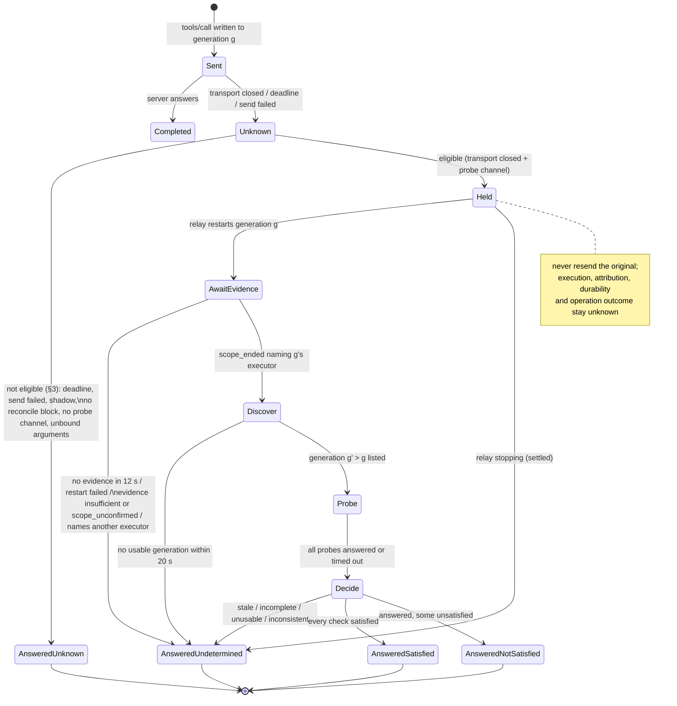

# Reconciliation contract, version 2

**Status:** implemented in the working tree (uncommitted) on 2026-10-16.
**Revised 2026-10-17 (Week 4C):** in scope mode the server gets an explicit minimal environment (not the relay's) and a neutral working directory (§4.4.4).

**Revised 2026-10-17 (Week 4B):** the server is stripped of `CAP_SYS_ADMIN` before it runs (§4.4.4 Privilege); the scope is a lifecycle boundary, not a sandbox.

**Revised 2026-10-17 (Week 4A):**
- the CLI executor scope, `--executor-scope pid-namespace` (§4.3, new §4.4);
- `scope_unconfirmed` evidence (§4.1);
- one overall budget per reconciliation, `max_seconds`, which replaces the summed worst case (§5.1);
- `io.stateguard/treatAsSuccess: false` (§7).

The text this revision replaced is preserved byte-for-byte in `/root/stateguard-captures/week4a/baseline/tree/docs/runtime/RECONCILIATION_CONTRACT_V2.md` (sha256 prefix `2f73f92c0c5239ce`). The decision record is `docs/runtime/WEEK4_CLI_EXECUTOR_SCOPE.md`.

**Code:**
- `src/stateguard/adapters/mcp/reconcile.py` — rules, no I/O;
- `src/stateguard/adapters/mcp/ledger.py` — states;
- `examples/mcp/stdio_proxy.py` (`StdioRelay`) — runtime;
- `src/stateguard/adapters/mcp/executor_scope.py` — the CLI's PID-namespace executor scope (§4.4).

**Evidence and decision record:** `docs/runtime/WEEK3_RECONCILIATION_CONTRACT_V2.md`.

Everything below describes behaviour that is implemented and tested, unless it is marked **Proposed — not implemented**.

## 1. What reconciliation is for

A `tools/call` whose outcome is **unknown** may or may not have executed. Reconciliation answers one narrow question about it: did an operator-declared, read-only predicate hold when it was observed? It never answers four other questions, and it never presents them as answered:

| Question | Answer under this contract |
|---|---|
| What state was observed, and when? | `io.stateguard/postcondition`, plus `io.stateguard/observation` (the checks and the observation window) |
| Did this request execute? | always `executionState: unknown` |
| Did this request cause the observed state? | always `attribution: unknown` |
| Does the observed state still hold? | always `durability: not_established` |
| Should the client treat the operation as successful? | always `operationOutcome: unknown`. The answer is a JSON-RPC error, never a successful tool result. |

**Invariant:** an unknown outcome never triggers an automatic resend of the original invocation, whatever the probes observe. There are no retries, no compensation and no replanning in this path.

## 2. Invocation lifecycle: where "unknown" comes from

The `InvocationLedger` tracks each client request through these states:

- `PENDING` — received, not yet written;
- `SENT` — written to a server generation;
- then one of:
  - `COMPLETED` — answered;
  - `ANSWERED_LOCALLY` — the relay answered and nothing reached a server;
  - `UNKNOWN` — sent, and no answer is coming.

A request becomes `UNKNOWN` in three cases:
- **Transport closed:** the server's stdout closed while the request was `SENT`.
- **Deadline:** `--call-deadline` expired.
- **Send failed:** the write may have been partial.

Only the first is ever eligible for reconciliation. After a deadline or a failed send, the original executor may still be working, so probing it would race that executor.

## 3. Eligibility: all of these, or no reconciliation

An `UNKNOWN` request is reconciled only if all of the following hold. If any check fails, the client is answered at once with `undetermined`, and the reason says which check failed.

1. It is a `tools/call` whose `(tool, server)` has a validated `reconcile` block (§6).
2. The relay is not in shadow mode. Shadow mode never probes, never restarts for reconciliation, and never changes client-visible traffic.
3. The unknown came from the transport closing (`Observed.UNKNOWN_TRANSPORT`).
4. A probe channel exists: the relay will restart the server (`max_restarts ≥ 1`, policy `after-unknown`, restarts left).
5. The call's arguments are held, and every probe binds to string arguments the call actually had.

Eligible calls are **held**: the client's answer waits while a worker carries out §4 and §5.

## 4. Termination evidence: the trust boundary

A probe means nothing while anything that could still perform the original operation is alive. So before any probe, the relay waits (at most `TERMINATION_WAIT_SECONDS`, 12 s, and never past the reconciliation's budget, §5.1) for the restart that replaces the call's server generation. That restart must report `TerminationEvidence` that **applies to that generation's executor**.

### 4.1 What counts

| Evidence (`TerminationKind`) | Who can produce it | Sufficient? |
|---|---|---|
| `not_reported` | A restart factory returning a plain `(stdin, stdout)` pair | no |
| `direct_child_reaped` | `StdioRelay`'s standard entry point; any process-based factory | **no.** A descendant that started its own session or group is not the child. |
| `process_group_empty` | A factory that kills a process group and checks it is empty | **no.** Group membership can be escaped with `setsid`. |
| `scope_unconfirmed` | The CLI executor scope (§4.4) when it could not confirm, within its deadline, that the generation's namespace is empty | **no** |
| `scope_ended(scope, executor=…)` | An **embedder** that confirmed a scope ended: every thread or process that could execute calls sent to `executor` ran inside that scope. Also the **CLI executor scope** (§4.4), which produces it from its own observation. | **yes**, subject to §4.2 |

### 4.2 `scope_ended` is an assertion, bound to one executor

- **It is the embedder's claim** — except when the CLI's own executor scope (§4.4) produced it. StateGuard cannot observe an embedder's scope and does not verify the claim. It requires the claim to be explicit (a named constructor with a non-empty `scope`), and it logs it as an `executor_termination` audit event.
- **It is bound to one executor.**
  - Every server generation has an executor identity, given by the embedder when that generation starts: `StdioRelay(..., executor=…)` for the first, `Restarted(..., executor=…)` for each restart.
  - Identities are validated: 1–120 characters, `[A-Za-z0-9][A-Za-z0-9._:/@-]*`. They must be unique within a relay; a malformed or reused identity is rejected (logged), and that generation gets no identity.
  - The evidence must name exactly the identity of the generation the call was sent to. Evidence naming another executor is refused. So is evidence from an earlier restart returned again, and evidence for a generation that has no identity.
- **What it does cover:** the threads and processes inside the scope, including detached descendants, if the scope contains them.
- **What it never covers:** external systems the executor handed work to — remote APIs, databases, queues, other hosts — and other actors. They can keep changing state after the scope has ended.

### 4.3 Deployments

| Deployment | Can reconcile? | Why |
|---|---|---|
| `python examples/mcp/stdio_proxy.py` (the CLI) without `--executor-scope` | **No: refused at startup** | It can only reap its direct child. An effects file with any `reconcile` block is rejected before a server starts, in every mode (auto, shadow, passthrough), with an error naming the missing capability. Without `reconcile` blocks the CLI behaves exactly as before. |
| The CLI with `--executor-scope pid-namespace` | **Yes — experimental, opt-in; Linux with CAP_SYS_ADMIN only** (§4.4) | Each server generation runs as the only child of init of its own PID namespace. The relay itself confirms the namespace empty before it reports `scope_ended` for that generation's identity. The capability is verified before any server starts; it is never downgraded. Shadow and passthrough still refuse `reconcile` blocks. |
| An embedding whose restart factory returns `Restarted(..., TerminationEvidence.scope_ended(...), executor=...)` for a scope it controls | Yes | The embedder's assertion (§4.2) |
| The reference embedder `benchmarks/domains/mcp_server_filesystem/embedded_relay.py --scope pid-namespace` | Yes, on Linux with PID-namespace permission | Each generation is init of its own PID namespace, and the kernel kills every process in it when init exits. The embedder checks `/proc` until none is left, then asserts `scope_ended`. **Benchmark and test harness only — not a supported product configuration.** |
| The same embedder with `--scope direct-child` | No probes | Reports `direct_child_reaped`, as the CLI would |

### 4.4 The CLI executor scope (`--executor-scope pid-namespace`)

**Experimental, opt-in.** Tested only on Linux 6.18 as root in one container (`docs/runtime/WEEK4_CLI_EXECUTOR_SCOPE.md`).

#### 4.4.1 Five different things

Each is reported separately; none implies the next.

| # | Concept | What establishes it | What it never establishes |
|---|---|---|---|
| 1 | **Process confinement** — every process the server generation starts is inside one kernel PID namespace | The kernel: the first child after `unshare(CLONE_NEWPID)` is PID 1 of the new namespace. Every descendant, including after `setsid` or a double fork, stays in it. It cannot join an ancestor PID namespace. | anything about processes outside the namespace |
| 2 | **Scope termination** — no process of that generation can still act | Three checks: init was reaped; the helper and the relay each found no `/proc` entry in that namespace; all within `END_TIMEOUT_SECONDS`. Reported as `scope_ended`, bound to that generation's identity. | that the lost call executed, or did not |
| 3 | **Predicate observation** — what the declared read-only probes saw, and when | §5 | causality, durability, operation success |
| 4 | **Operation outcome** — did the operation succeed? | **Nothing in StateGuard.** Always `operationOutcome: unknown`, `treatAsSuccess: false`. | — |
| 5 | **External effects** — remote APIs, databases, queues, other hosts, local daemons the server talked to (over a socket, D-Bus, a container runtime, `at`, `systemd-run`, …) | **Nothing in StateGuard.** A process boundary is never evidence that those have stopped acting. | — |

#### 4.4.2 Topology, per server generation

```
relay ── server stdin/stdout pipes ──────────────────────────────┐
  │ control pipe (helper→relay: started/ended events; relay closes it to end the scope)
  ▼                                                              │
helper   python -m stateguard.adapters.mcp.executor_scope serve  │
  │      outside the namespace; single-threaded; reaps init      │
  │ fork after unshare(CLONE_NEWPID)                             │
  ▼                                                              │
init     PID 1 inside; PR_SET_PDEATHSIG=SIGKILL; reaps orphans   │
  │ fork + execvp(command)                                       ▼
server   stdin/stdout are the relay's pipes; fds ≥ 3 closed; SIGINT/SIGTERM/SIGPIPE at default
```

**Starting a generation.** `PidNamespaceScope(command)` starts the helper with the server's two pipe ends and a control pipe, then closes its own copies of those ends. The helper:
1. unshares the PID namespace;
2. forks init;
3. closes its copies of the server's stdio;
4. reports `started` (init's PID and namespace link).

Init:
1. arms `PR_SET_PDEATHSIG`;
2. checks the helper is still alive, using an "alive" pipe;
3. puts `/dev/null` on its own stdio;
4. forks the server, and exits with the server's status when the server exits.

If no `started` report arrives within `START_TIMEOUT_SECONDS` (5 s), the helper is killed and `ScopeError` is raised:
- at startup, the CLI exits with status 2;
- on a restart, the restart fails (logged `restart_failed`) and is counted.

**Identity.** Each generation gets `pidns-<namespace inode>-<helper pid>-<n>`. Here `n` is a per-process counter, so the identity is unique even if the kernel reuses an inode. It goes to `StdioRelay(executor=…)` or `Restarted(…, executor=…)`, and §4.2's binding rules apply unchanged.

**stdio independence.** No wrapper process holds the server's stdin or stdout: the helper and init close their copies before the server runs. The relay therefore sees the server's stdout close as soon as the server **and its descendants** close it. A descendant that inherited stdout keeps the pipe open, exactly as it would without a scope. This was a liveness gap in the Week 3 reference embedder, whose wrapper held the pipe; that gap is closed here.

#### 4.4.3 Ending a generation, and what is reported

When the relay restarts after the server's stdout closes, it **first** ends the old scope and records the evidence, and only then starts the next scope. Ending a scope is idempotent:

1. The relay closes the control pipe.
2. The helper sees EOF. If init has not been reaped, the helper sends SIGKILL through init's **pidfd**, so the signal can never reach a reused PID.
3. When init exits, the kernel SIGKILLs every other process in the namespace. Init's exit becomes visible only once they are gone.
4. The helper reaps init, counts the namespace members still visible in `/proc`, reports `ended {status, members_left}`, and exits.
5. The relay waits for that report and for the helper to exit, then scans `/proc` itself.

**The namespace is pinned.** From start until its own scan, the relay holds a reference to the namespace: an open descriptor of `/proc/<init>/ns/pid`, checked to be init's by its parent PID. The kernel therefore cannot give the namespace's inode number to a newer namespace in the meantime, so neither scan can be about the wrong namespace.

Without the reference, the next generation's namespace reused the inode immediately in 20 of 20 trials. Each of those turned a confirmed end into `scope_unconfirmed`: fail-closed, but the probe would wrongly have been refused.

| Result | Condition | Reconciliation |
|---|---|---|
| `scope_ended("linux pid namespace pid:[…]: init reaped, no member left", executor=<identity>)` | `ended` received, `members_left == 0`, helper exited, and the relay's own scan is empty — all within `END_TIMEOUT_SECONDS` (5 s) | probes may run (§5) |
| `scope_unconfirmed(<why>)` | anything else: no report in time (the helper is stopped or wedged), a member still visible (for example in uninterruptible sleep), or the helper did not exit | **never probes**; `undetermined` |

On `scope_unconfirmed` the relay then kills the helper, which sends SIGKILL to init through `PR_SET_PDEATHSIG`. This cleanup is not used as evidence.

**Signals and refusal to exit.** The server is never asked to stop gracefully: ending a scope is SIGKILL to init. A process that ignores or blocks SIGTERM, or any other catchable signal, cannot outlive init's end: SIGKILL cannot be caught, blocked or ignored. The exception is a process in uninterruptible sleep: it delays the namespace's end and is reported as `scope_unconfirmed` past the deadline.

**Abrupt parent death.**
- **Relay killed** (SIGKILL, crash): the helper reads EOF on the control pipe and kills init.
- **Helper killed:** init receives SIGKILL (`PR_SET_PDEATHSIG`). The alive-pipe check covers a helper that dies before that is armed.

Either way the kernel empties the namespace. The scope creates no files, mounts, cgroups or users, so nothing is left to clean up.

**A helper stopped by SIGSTOP** makes `end()` time out. That gives `scope_unconfirmed`; then the relay SIGKILLs the helper, init dies by PDEATHSIG, and the namespace empties.

**Maximum waits:**

| Step | Bound |
|---|---|
| Capability probe at startup | `START_TIMEOUT_SECONDS` (5 s) |
| Each scope start | 5 s |
| Each scope end | `END_TIMEOUT_SECONDS` (5 s) to decide, plus up to 5 s more to kill a helper on the unconfirmed path |

The evidence wait (`TERMINATION_WAIT_SECONDS`, 12 s) covers one end (5 s) plus one start (5 s). A slower restart is answered `undetermined` ("no restart replaced the server…"). All of these waits are capped by the reconciliation's own budget (§5.1).

**Resource limits.** The scope limits **no** resource: CPU, memory, process count and file descriptors are as without a scope, inherited rlimits apply, and no cgroup is created. Each generation adds two processes, the helper and init, and only one scope is live at a time: the old one ends before the next starts.

**Privilege (revised 2026-10-17, Week 4B — see `docs/runtime/WEEK4B_EXECUTOR_SECURITY_AUDIT.md`).**
- The helper needs `CAP_SYS_ADMIN` in its user namespace, to call `unshare(CLONE_NEWPID)`.
- **`CAP_SYS_ADMIN` is dropped before the server is executed.** Enabling the scope forces the relay to hold `CAP_SYS_ADMIN`, which the server must never inherit. In the server child, init clears the ambient capability set, sets `no_new_privs`, and (for a root exec) drops `CAP_SYS_ADMIN` from the bounding set, then confirms from `/proc` that no path can give the execed server `CAP_SYS_ADMIN`. If that confirmation fails the server is never executed (fail closed), and the startup capability check refuses an environment where the drop does not work.
- The server runs with the relay's **user and group** (no setuid, no user namespace), but never with `CAP_SYS_ADMIN`. A non-root server execs with no capabilities at all; a root server keeps the rest of root's capabilities.
- **This is a lifecycle boundary, not a sandbox.** The server still shares the relay's mount, network, IPC and user namespaces, and its resource limits (no cgroup, no added rlimit). File-system, network and resource isolation are **not** provided.
- The command is executed from an argument vector: no shell, so there is no shell injection.
- The relay resolves `command[0]` to an absolute path before starting (so a relative command still runs under the server's own working directory).

**Environment and working directory (added 2026-10-17, Week 4C — `docs/runtime/WEEK4C_ENVIRONMENT_AND_RESOURCE_BOUNDARY.md`).**
- In scope mode the server does **not** inherit the relay's environment. It gets a minimal baseline (`PATH`) plus only what the operator passes with `--env NAME=VALUE` or `--env-passthrough NAME`. The server's environment is delivered over a private pipe (never the argv) and applied with `execvpe`; the helper runs with its own empty environment. The audit logs environment variable **names** only, never values.
- The server's working directory defaults to a neutral `/` in scope mode, overridable with `--server-cwd DIR` (validated to exist). Outside scope mode the environment and directory are inherited as before.
- Misconfiguration (a malformed/duplicate/missing env entry, a non-existent `--server-cwd`, or any of these flags without a scope) is refused before any server starts.

**Configuration** is validated before any server starts:
- `--executor-scope` is `none` (default) or `pid-namespace`;
- reconcile blocks need `pid-namespace`, `--restart N` (N ≥ 1) and `--restart-policy after-unknown`;
- reconcile blocks are refused in shadow and passthrough;
- the server program must exist;
- `--env` / `--env-passthrough` / `--server-cwd` are well-formed, conflict-free, and used only with a scope;
- the capability check must pass.

Any failure exits with status 2 and an actionable message, having started nothing.

#### 4.4.4 Prerequisites and platform behaviour

**Required:**
- Linux with PID namespaces (`/proc/self/ns/pid`) and `pidfd_open` (Linux ≥ 5.3);
- `/proc` mounted for the relay's PID namespace, so members are visible;
- permission to create a PID namespace.

**Containers:** they must grant `CAP_SYS_ADMIN`, and seccomp must allow `unshare(CLONE_NEWPID)` and `pidfd_open`/`pidfd_send_signal`. Docker's default seccomp profile blocks `unshare` without `CAP_SYS_ADMIN`.

`check_pid_namespace_capability()` verifies all of this before any server starts. It runs a real namespace with a detached (`setsid`) descendant, kills its init, and requires the namespace to be seen empty.

| Environment | Behaviour |
|---|---|
| Linux with CAP_SYS_ADMIN and the above | supported (experimental); tested only on Linux 6.18, root, one container |
| Linux without the permission (unprivileged user, restricted container, seccomp) | refused at startup: "unshare(CLONE_NEWPID): Operation not permitted … needs CAP_SYS_ADMIN …" (tested as uid 65534) |
| Linux without `/proc/self/ns/pid`, or without pidfd | refused at startup, with the reason |
| macOS, Windows, other platforms | refused at startup: "PID namespaces need Linux; this platform is …". There is no fallback scope. |

**Unprivileged user namespaces are not used.** `unshare(CLONE_NEWUSER|CLONE_NEWPID)` would work without privilege, but it changes the identity the server runs as. That is a semantic change this contract does not take silently.

## 5. Observation

After sufficient evidence:

1. **Discovery.** The worker waits for a restarted generation (newer than the call's) whose tool listing has synced. There is one budget, `DISCOVERY_BUDGET_SECONDS` (20 s), however many restarts are allowed.
2. **Probes.** It sends the declared probes **only** to that generation, in order, each answered within the block's `timeout_seconds`. Before each probe it re-checks that the probe tool is in that generation's current listing and not annotated `readOnlyHint: false` or `destructiveHint: true`.
3. **Window.** The observation window is recorded: `observed_from` when probing starts, `observed_to` after the last answer (UTC, milliseconds).
4. **Verdict.** `decide()` applies the rules in this order:

| Condition | Outcome |
|---|---|
| Termination not established for this executor (checked before probing) | `undetermined`, nothing probed |
| The server generation changed during probing | `undetermined` ("stale") |
| Not every probe ran | `undetermined` ("incomplete") |
| Any probe is `tool_error`, `protocol_error`, `malformed`, `unavailable` (timeout, no answer, server lost) or `invalid` (unlisted or disqualified tool) | `undetermined` |
| Two reads of the same tool and arguments disagreed | `undetermined` ("inconsistent") |
| Every probe `satisfied` | `observed_satisfied` |
| Otherwise (every probe answered; some `unsatisfied`) | `observed_not_satisfied` ("does not show the request did not execute") |

### 5.1 Time bounds: one overall budget (revised 2026-10-17)

Each `reconcile` block has **one** budget, `max_seconds`:
- default `DEFAULT_BUDGET_SECONDS`, 30 s;
- must be in (0, `MAX_BUDGET_SECONDS` = 60];
- `ReconcileSpec.worst_case_seconds` returns it.

The deadline is set when the call is held. Every later wait is capped by the time left:
- the evidence wait, at most 12 s;
- discovery, at most 20 s;
- each probe, at most `timeout_seconds`.

So the waits never compound.
- If the budget runs out before a probe is sent, the rest are not sent: the audit log records `reconcile_budget_exhausted`, and the verdict is `undetermined` ("incomplete").
- A block whose `timeout_seconds × len(probes)` exceeds `max_seconds` is refused when the file loads, because its probes could never all finish.

The client's answer is held at most `max_seconds`, plus the time to write it. If the relay stops first, §8 applies.

The earlier bound was the sum TERMINATION + DISCOVERY + Σ probe timeouts, a ceiling of 150 s. It is superseded: it compounded the timeouts.

## 6. Probe declarations

A probe is declared in the operator's effects file, on the entry of the tool to reconcile:

```json
{"name": "move_file", "effect": "non_idempotent",
 "reconcile": {"timeout_seconds": 5, "probes": [
   {"tool": "read_text_file", "arguments": {"path": "$source"},
    "expect": "absent", "absent_marker": "ENOENT"},
   {"tool": "read_text_file", "arguments": {"path": "$destination"},
    "expect": {"text_sha256_equals": "<64 lowercase hex>"}, "absent_marker": "ENOENT"}]}}
```

Every rule below is checked when the file is loaded. A violation raises `ReconcileConfigError`, and the file is refused.

- **Read-only, explicitly.** The probe tool must be declared `read_only` in the same file. Server annotations can disqualify a tool, but they can never qualify one. A tool cannot probe itself, and a `read_only` tool has nothing to reconcile.
- **Constrained arguments.**
  - Every probe argument is a `$name` reference to one of the original call's arguments; literals are refused.
  - The only other inputs are values declared in this file: `absent_marker`, and `sha256`.
  - At call time, a reference to a missing or non-string argument leaves the outcome `undetermined`, and nothing is probed.
- **Known predicates only:**

| `expect` | What a satisfied check shows | Strength |
|---|---|---|
| `"present"` | A non-error result | presence |
| `"absent"` (with `absent_marker`) | An error result whose text contains the marker | presence |
| `{"text_equals_argument": "$name"}` | The first text block equals that call argument. `$name` may not be one of the probe's own arguments, which would be ambiguous. | content |
| `{"text_sha256_equals": "<hex>"}` | The SHA-256 of the first text block (UTF-8) equals a declared constant. Use it only for a **known** expected result. | content |

- **Malformed or unsupported specifications are refused:** unknown keys, unknown `expect` forms, a malformed digest, a missing or overlong `absent_marker`, more than `MAX_PROBES` (4) probes, a `timeout_seconds` outside (0, 30], and any resend-like key (`resend`, `retry`, `exclusive`, …).
- **No ambiguous objects.** In a file with `reconcile` blocks, a key repeated in any JSON object is an error; JSON parsers otherwise keep the last value silently. Files without `reconcile` blocks are read exactly as before.

**Strength is reported, never upgraded.**
- Each predicate is described in `io.stateguard/observation.predicates` with its tool, argument names, check and strength.
- `content_checked` is true only when every positive (non-`absent`) check is a content check.
- A presence-only `observed_satisfied` says so: "the declared presence-only predicate (content was not checked)". It also lists "that any content is correct" among what it does not establish.

## 7. Client-facing result

The JSON-RPC envelope is **unchanged**: the same error code, `-32000`, as every unknown outcome. That is deliberate. An error-only client treats every reconciled call as not successful, which is the safe reading of an unknown outcome. Both the Python and TypeScript SDKs surface `data` (Week 3 audit, §9).

**`error.data` when a reconciliation verdict is attached:**

| Key | Values |
|---|---|
| `io.stateguard/executionState` | `unknown` |
| `io.stateguard/reason` | `transport_closed` (`deadline` and `send_failed` are never probed) |
| `io.stateguard/reconciliationContract` | `"2"` |
| `io.stateguard/postcondition` | `observed_satisfied` / `observed_not_satisfied` / `undetermined` |
| `io.stateguard/attribution` | `unknown` |
| `io.stateguard/durability` | `not_established` |
| `io.stateguard/operationOutcome` | `unknown` |
| `io.stateguard/treatAsSuccess` | `false`, always: a reconciled call must never be treated as a success, whatever was observed (added 2026-10-17) |
| `io.stateguard/observation` | When probes ran: `observed_from`, `observed_to`, `predicates`, `content_checked` |
| `io.stateguard/reconciliation` | `reasons`, `establishes`, `does_not_establish`, `probes` (statuses and coarse forms only) |

**Messages:**
- **`observed_satisfied`:** "Outcome unknown: …. Read-only probes observed the declared [presence-only] predicate holding at <time>. That does not show this request executed or caused it, that it still holds, or that the operation succeeded. Do not resend it."
- **`observed_not_satisfied`:** "… do not retry it unless it is safe to run twice. Read-only probes observed the declared predicate not holding at <time>; that does not show the request did not execute."
- **`undetermined`:** "… Reconciliation could not establish whether the declared predicate holds."

**Contract v1 → v2 changes:**
- `verified` and `not_verified` are renamed `observed_satisfied` and `observed_not_satisfied`.
- New keys: `reconciliationContract`, `durability`, `operationOutcome`, `observation`, `establishes`, `does_not_establish`.

Week 3 v1 was never released, so no deployed client depends on the old names.

## 8. Shutdown, routing and exactly-once answers

**Exactly one answer.** A held reconciliation goes `held → answering → removed`. Only the path that moves it from `held` to `answering` may answer it.

**Shutdown.** When the relay stops:
1. Every reconciliation still `held` is answered `undetermined`.
2. Answers already `answering` are waited for, at most `RECONCILE_STOP_WAIT_SECONDS` (2 s; a documented constant, not a sleep).
3. Each one still unwritten after that is logged `reconcile_answer_unconfirmed`. The process then exits, so that client gets no answer. This is the deterministic fallback.

**What "written" means.** `reconcile_answered.written_to_stream` means flushed into the client's stream. It never means the client read it.

**Matching responses to requests.** Responses are matched to the relay's own requests by **exact issued id**, never by prefix:
- **Probe ids.** They are `stateguard-reconcile:<per-relay random nonce>:<n>`.
  - Only the first answer to a pending probe on its own generation is accepted.
  - Late, duplicate and other-generation answers to issued probes are dropped and logged.
- **Relay-owned listings.** Ids are `stateguard-relay:<n>`, matched against the issued table.
  - An answer for a settled id is dropped unless a client request with that id is in flight, in which case it is the client's.
- **Retries.** Ids are `stateguard-retry:<n>`, matched against the issued-to-client map.

All other responses take the normal path to the client, however their ids look. The relay never issues an id that a client has already used.

**Remaining exposure.** If a client reuses an id the relay issued while that relay request is still pending, the first answer goes to the relay (logged `response_id_collision`) and the next one goes to the client. JSON-RPC ids are per-sender, so this cannot be fully avoided without rewriting client ids.

## 9. State diagram



## 10. Escalate, never probe

These cases always escalate (`undetermined`, or a plain unknown answer) and never probe:
- a deadline-expired or partially-sent call;
- shadow mode;
- no restart policy, or no restarts left;
- missing or non-string bound arguments;
- termination not established for the call's executor, including restart failure or a slow restart;
- no usable restarted server within the discovery budget;
- a probe tool that is unlisted, or annotated as not read-only.

## 11. Not supported

**Not supported by this implementation:**
- reconciliation through the standard CLI **without** `--executor-scope pid-namespace`, or on any platform other than Linux with CAP_SYS_ADMIN;
- verifying an embedder's `scope_ended` claim;
- covering effects in external systems;
- detecting a probe server that misreports state, which is an assumption of the trust model;
- content checks for results that are neither a call argument nor a known constant;
- consistency across several different reads, beyond re-reading the same key;
- any recovery action (resend, compensation, replanning).

- resource limits on the executor scope (cgroups);
- an executor scope on macOS or Windows (a container or job object would be needed there; none is implemented);
- unprivileged user-namespace scopes (§4.4.4).

**Implemented 2026-10-17 (was: proposed):** the opt-in CLI executor scope, `--executor-scope pid-namespace` (§4.4). It still does not cover external systems; that limit stays in the contract. The stdio limitation the proposal noted, a namespace wrapper holding the server's stdio, does not apply to it (§4.4.2).
